# Blur Generator

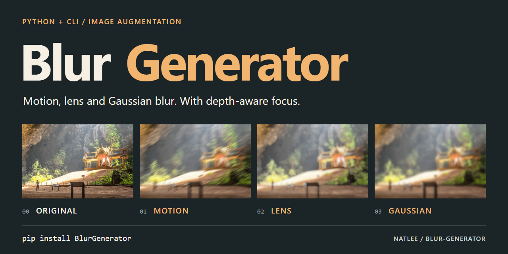

[](https://pypi.org/project/BlurGenerator/)
[](https://pypi.org/project/BlurGenerator/)
[](https://github.com/NatLee/blur-generator/actions/workflows/test.yml)
[](LICENSE)
[](https://pypistats.org/packages/blurgenerator)

Blur Generator adds **motion**, **lens** (bokeh) or **Gaussian** blur to images, from Python or from the
command line. Give it a depth map and it blurs every part of a photo by how far away it is, including a
camera-like depth of field that keeps one distance sharp and blurs what lies in front of and behind it.
Use it to make training data for blur detection or deblurring models (see
[simply-blur-detector](https://github.com/NatLee/simply-blur-detector)), or just to fake a portrait mode.

| Original | Motion |
|:---:|:---:|
|  |  |
| **Lens** | **Gaussian** |
| 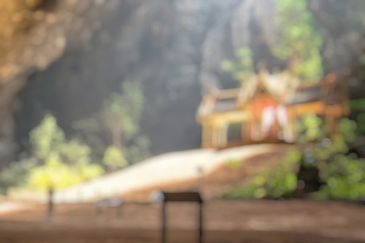 | 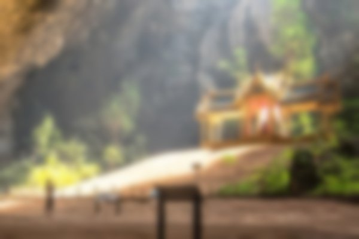 |

## Installation

```bash
pip install BlurGenerator
```

It needs Python 3.7 or newer and installs NumPy and the headless build of OpenCV
(`opencv-python-headless`). That is the same `cv2` without the windows of `cv2.imshow`, so it also works on
servers and in slim Docker images (for example `python:3.12-slim`) without extra system libraries.

**Already have `opencv-python`?** Versions up to 1.2.0 installed it, and other packages may too. It and
`opencv-python-headless` install the same `cv2` folder, so they get in each other's way: the one installed
last wins, and uninstalling either one removes `cv2` for both. Keep only one of them:

```bash
# You don't need cv2.imshow: keep the headless build.
pip uninstall -y opencv-python opencv-python-headless
pip install --force-reinstall BlurGenerator

# You do need cv2.imshow: keep the full build, and install BlurGenerator without its OpenCV.
pip uninstall -y opencv-python opencv-python-headless
pip install opencv-python
pip install --no-deps BlurGenerator
```

BlurGenerator works with either build. With the second way, `pip check` reports that
`opencv-python-headless` is missing; that is expected. The full build needs a few system libraries on a
server or in a slim image (`libxcb.so.1` or `libGL.so.1` missing); on Debian or Ubuntu:
`apt-get install -y libgl1 libglib2.0-0`.

## Quick start

The examples use the sample images in [`doc/`](doc/).
Run them from the root of a clone of this repository, or point them at your own images.

From the command line:

```bash
blurgenerator --type lens --input ./doc/readme/sample.jpg --output lens.jpg
```

From Python:

```python
import cv2
from blurgenerator import lens_blur

img = cv2.imread('./doc/readme/sample.jpg')
result = lens_blur(img, radius=5, components=4, exposure_gamma=2)
cv2.imwrite('./lens.jpg', result)
```

Both write the same picture: the Python call spells out the defaults the command uses.

## The three blur types

The pictures at the top were made with these commands:

```bash
blurgenerator --type motion --motion_blur_size 25 --input ./doc/readme/sample.jpg --output motion.jpg
blurgenerator --type lens --lens_radius 8 --lens_exposure_gamma 5 --input ./doc/readme/sample.jpg --output lens.jpg
blurgenerator --type gaussian --gaussian_kernel 31 --input ./doc/readme/sample.jpg --output gaussian.jpg
```

The same in Python:

```python
import cv2
from blurgenerator import motion_blur, lens_blur, gaussian_blur

img = cv2.imread('./doc/readme/sample.jpg')
cv2.imwrite('./motion.jpg', motion_blur(img, size=25, angle=30))
cv2.imwrite('./lens.jpg', lens_blur(img, radius=8, components=4, exposure_gamma=5))
cv2.imwrite('./gaussian.jpg', gaussian_blur(img, 31))
```

- **Motion blur** smears the image along a straight line, as if the camera moved: `size` is the length in
  pixels and `angle` the direction in degrees.
- **Lens blur** imitates an out-of-focus lens: bright spots turn into round discs. `radius` is the size of
  the disc and `exposure_gamma` how much highlights bloom. It follows
  [Circularly symmetric convolution and lens blur](http://yehar.com/blog/?p=1495).
- **Gaussian blur** is a plain soft blur. With the default `sigma=5`, kernels wider than about 31 pixels look
  the same; pass `sigma=0` to let the kernel size set the strength.

### Decimal lens radii

A decimal `radius` gives a disc between the two whole sizes around it. Here one bright pixel goes through
`lens_blur()` with its other settings left at the defaults, enlarged 10 times so that every pixel shows:

| `radius=2` | `radius=2.5` | `radius=3` |
|:---:|:---:|:---:|
| 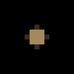 | 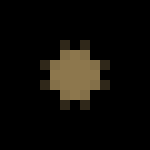 | 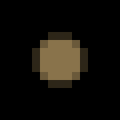 |

Up to 1.2.0 a decimal radius blurred exactly like the next whole number: 2.5 gave the picture of 3.
Whole radii give exactly the same result as before.

## Blur by depth

A depth map is a grayscale image, the same size as the photo, whose values (0-255) say how far away each
pixel is. The depth map tells Blur Generator how much to blur each part of the image: it splits the depth
values into layers (`num_layers`) and blurs each layer by its own amount, from `min_blur` at depth 0 to
`max_blur` at depth 255. This feature started with
[issue #1](https://github.com/NatLee/blur-generator/issues/1).

| Photo | Depth map (brighter is nearer) |
|:---:|:---:|
| 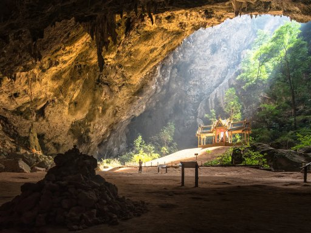 | 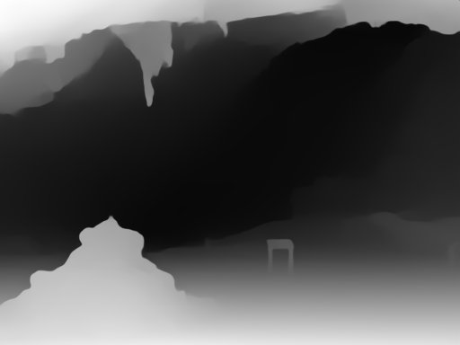 |

In this depth map nearer things are brighter, so the blur grows towards the camera: the rocks in front get
blurry and the far end of the cave stays sharp.

| Motion | Lens | Gaussian |
|:---:|:---:|:---:|
|  |  |  |

```bash
blurgenerator --type motion --input ./doc/depth-test.jpg --input_depth_map ./doc/depth-map-test.png --depth_max_blur 50 --output depth-motion.png
blurgenerator --type lens --input ./doc/depth-test.jpg --input_depth_map ./doc/depth-map-test.png --depth_max_blur 40 --output depth-lens.png
blurgenerator --type gaussian --input ./doc/depth-test.jpg --input_depth_map ./doc/depth-map-test.png --depth_max_blur 50 --output depth-gaussian.png
```

```python
import cv2
from blurgenerator import lens_blur_with_depth_map

img = cv2.imread('./doc/depth-test.jpg')
depth_map = cv2.imread('./doc/depth-map-test.png')
result = lens_blur_with_depth_map(img, depth_map, components=4, exposure_gamma=2, max_blur=40)
cv2.imwrite('./depth-lens.png', result)
```

`motion_blur_with_depth_map` and `gaussian_blur_with_depth_map` work the same way. Want it the other way
round, sharp in front and blurry behind? Swap the two values (`min_blur=40, max_blur=1`) or invert the depth
map (`255 - depth_map`).

### Focus on a depth (depth of field)

A real camera keeps one distance sharp and blurs both what is closer and what is farther away. Pick that
distance with `focus` (a depth value from 0 to 255) or with `focus_point` (a pixel of the depth map whose
depth you want sharp), and optionally keep a whole band of depths sharp with `focus_range`.
This answers [issue #5](https://github.com/NatLee/blur-generator/issues/5).

| Default: blur grows with depth | `focus_point=(480, 1150), focus_range=20` |
|:---:|:---:|
|  | 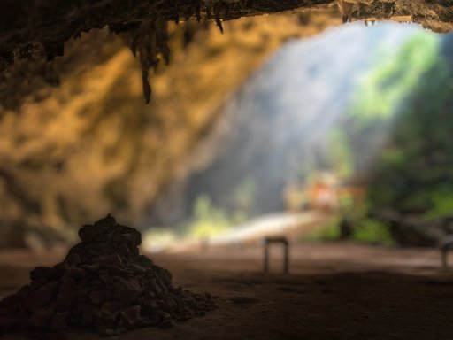 |

On the right the pile of rocks (depth 179 at pixel 480, 1150) is sharp. The cave behind it and the floor
and ceiling in front of it are blurred, more the further their depth is from 179.

```bash
blurgenerator --type lens --input ./doc/depth-test.jpg --input_depth_map ./doc/depth-map-test.png --depth_max_blur 40 --depth_focus_point 480 1150 --depth_focus_range 20 --output focus.png
```

```python
import cv2
from blurgenerator import lens_blur_with_depth_map

img = cv2.imread('./doc/depth-test.jpg')
depth_map = cv2.imread('./doc/depth-map-test.png')
result = lens_blur_with_depth_map(img, depth_map, components=4, exposure_gamma=2, max_blur=40,
                                  focus_point=(480, 1150), focus_range=20)
# Same as focus=179, the depth of that pixel.
cv2.imwrite('./focus.png', result)
```

How much each depth is blurred, on a checkerboard with a depth map that goes from 0 on the left to 255 on
the right:

| | Depth 0 on the left, 255 on the right |
|---|:---:|
| Depth map |  |
| Default | 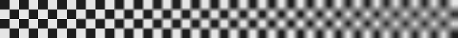 |
| `focus=128, focus_range=40` | 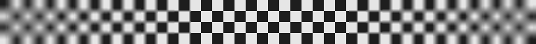 |

The rules with a focus:

- Depths within `focus_range / 2` of `focus` are not blurred at all (`focus_range=10` around 50 keeps 45-55
  sharp).
- Just outside that band the blur is about `min_blur`. It grows with the distance from the band and reaches
  `max_blur` at whichever end of the 0-255 scale is farther away.
- A depth in front of the band and one behind it at the same distance get the same blur.
- Without `focus`, `focus_point` and `focus_range` the result is exactly what it was before these options
  existed.

## The maths

This is exactly what the code computes, written as formulas. *I* is the input image and *O* the output,
both 8-bit (0 to 255), and every colour channel goes through the same steps. Pixel (*x*, *y*) is column
*x* and row *y*.

**Filtering.** All three blurs slide a kernel *K* over the image (OpenCV's `filter2D` and `GaussianBlur`).
For a kernel of *n* × *n* values, anchored at *a* = ⌊*n*/2⌋:

```math
(I \star K)(x, y) = \sum_{j=0}^{n-1} \sum_{i=0}^{n-1} K(i, j)\, I(x + i - a,\ y + j - a)
```

Pixels outside the image are mirrored (…, 2, 1, 0, 1, 2, …) for motion and Gaussian blur, and copied
from the nearest edge for lens blur. Results are rounded to whole numbers from 0 to 255.

**Motion blur** (`size` *n*, `angle` *θ*). Start with *L*, an *n* × *n* kernel that is 1 on row
⌊(*n* − 1)/2⌋ and 0 elsewhere. Turn it by *θ* counter-clockwise around its centre *c* = (*n* − 1)/2,
reading *L* between pixels by bilinear interpolation (0 outside the kernel), and scale it to sum to 1:

```math
(R_\theta L)(x, y) = L\big(c + (x - c)\cos\theta - (y - c)\sin\theta,\ \ c + (x - c)\sin\theta + (y - c)\cos\theta\big),
\qquad M = \frac{R_\theta L}{\sum R_\theta L}, \qquad O = I \star M
```

**Gaussian blur** (`kernel` *k*, `sigma` *σ*). OpenCV needs an odd size, so *k*′ = *k* + 1 when *k* is even
and *k*′ = *k* otherwise, and *h* = (*k*′ − 1)/2:

```math
g(t) = \frac{e^{-t^2 / 2\sigma^2}}{\sum_{s=-h}^{h} e^{-s^2 / 2\sigma^2}}, \qquad
G(i, j) = g(i - h)\, g(j - h), \qquad O = I \star G
```

With `sigma=0` OpenCV picks *σ* = 0.3 ((*k*′ − 1)/2 − 1) + 0.8 itself, and for *k*′ up to 7 it uses a fixed
binomial kernel instead.

**Lens blur** (`radius` *r*, `components` *m*, `exposure_gamma` *γ*). The kernel is a sum of *m* complex
Gaussians that together approximate a flat disc (see the Reference below). For *m* = 1 to 6 there is a
preset of numbers *a*<sub>*c*</sub>, *b*<sub>*c*</sub>, *A*<sub>*c*</sub>, *B*<sub>*c*</sub> per
component and a scale *s* (`kernel_params` and `kernel_scales` in `lens_blur.py`); larger *m* use the
preset for 6, smaller ones the preset for 1. The kernel is sampled at whole pixels *x* = −⌈*r*⌉ … ⌈*r*⌉, each measured in units of the
radius:

```math
u_x = \frac{s\,x}{r}, \qquad k_c(x) = e^{-a_c u_x^2} \big(\cos(b_c u_x^2) + i \sin(b_c u_x^2)\big)
```

```math
K(x, y) = \frac{1}{Z} \sum_{c=1}^{m} \Big( A_c\, \mathrm{Re}\big[k_c(x)\, k_c(y)\big] + B_c\, \mathrm{Im}\big[k_c(x)\, k_c(y)\big] \Big),
\qquad Z \text{ such that } \sum_{x, y} K(x, y) = 1
```

Bright spots are lifted to the power *γ* before filtering and brought back afterwards, which is what makes
them bloom into discs:

```math
O = \Big\lfloor 255 \cdot \min\Big(1,\ \max\big(0,\ (I/255)^{\gamma} \star K\big)^{1/\gamma}\Big) \Big\rfloor
```

The code filters with each component separately, first along the rows and then along the columns, and
adds the results up; that is the same as filtering with *K*.

**Blur by depth** (`num_layers` *n*, `min_blur` *b*<sub>0</sub>, `max_blur` *b*<sub>1</sub>). *D* is the
depth map in grayscale (a BGR depth map is converted with OpenCV's `COLOR_BGR2GRAY`), and
*d*<sub>lo</sub>, *d*<sub>hi</sub> are the smallest and largest values in the depth map. The depths are cut
into layers of height Δ, starting at *ℓ*<sub>*i*</sub>:

```math
\Delta = \max\Big(\Big\lfloor \frac{d_{hi} - d_{lo}}{n} \Big\rfloor,\ 1\Big), \qquad
\ell_i = d_{lo} + i\,\Delta \quad \text{for every } \ell_i < \max(d_{hi},\ d_{lo} + 1)
```

Layer *i* holds the pixels with *ℓ*<sub>*i*</sub> < *D* ≤ *ℓ*<sub>*i*</sub> + Δ (the first layer also
*D* = *ℓ*<sub>0</sub>), so every pixel is in exactly one layer. Its blur amount is the motion `size`, the
lens `radius` or the Gaussian `kernel` used for that layer, and 0 means no blur:

```math
\beta_i = \Big\lfloor b_0 + \frac{\ell_i}{255}\,(b_1 - b_0) \Big\rfloor, \qquad
O(x, y) = \mathrm{blur}_{\beta_i}(I)(x, y) \quad \text{for the layer } i \text{ that holds } (x, y)
```

**Focus** (`focus` *f*, `focus_range` *w*). With `focus_point=(x, y)` the focus is the depth of that
pixel, *f* = *D*(*x*, *y*). The layers then follow each pixel's distance *δ* from the sharp band instead of
its depth, and the blur reaches *b*<sub>1</sub> at the largest distance any depth can have, *δ*<sub>max</sub>:

```math
\delta = \Big\lceil \max\big(|D - f| - \tfrac{w}{2},\ 0\big) \Big\rceil, \qquad
\delta_{max} = \Big\lceil \max\big(f - \tfrac{w}{2},\ 255 - f - \tfrac{w}{2},\ 0\big) \Big\rceil
```

Pixels with *δ* = 0 keep their value. The others are cut into layers exactly as above, with *δ* in place of
*D* (so *d*<sub>lo</sub> and *d*<sub>hi</sub> are the smallest and largest *δ* among them), and

```math
\beta_i = \Big\lfloor b_0 + \frac{\ell_i}{\delta_{max}}\,(b_1 - b_0) \Big\rfloor
```

[A test](tests/test_readme_formulas.py) writes these
formulas out again with NumPy and compares them with the package: the motion and Gaussian kernels match to
float rounding, lens blur to within 1 of 255 for a few pixels, and blur by depth pixel for pixel.

## Command line

```text
usage: blurgenerator [-h] [--input INPUT] [--input_depth_map INPUT_DEPTH_MAP]
                     [--output OUTPUT] [--type TYPE]
                     [--motion_blur_size MOTION_BLUR_SIZE]
                     [--motion_blur_angle MOTION_BLUR_ANGLE]
                     [--lens_radius LENS_RADIUS]
                     [--lens_components LENS_COMPONENTS]
                     [--lens_exposure_gamma LENS_EXPOSURE_GAMMA]
                     [--gaussian_kernel GAUSSIAN_KERNEL]
                     [--depth_num_layers DEPTH_NUM_LAYERS]
                     [--depth_min_blur DEPTH_MIN_BLUR]
                     [--depth_max_blur DEPTH_MAX_BLUR]
                     [--depth_focus DEPTH_FOCUS]
                     [--depth_focus_range DEPTH_FOCUS_RANGE]
                     [--depth_focus_point X Y]

Add motion, lens or gaussian blur to an image, optionally guided by a depth
map.

options:
  -h, --help            show this help message and exit
  --input INPUT         Image to blur (.jpg, .jpeg or .png). Required.
  --input_depth_map INPUT_DEPTH_MAP
                        Depth map (.jpg, .jpeg or .png, same size as the
                        input) that decides how much each part of the image is
                        blurred. Optional.
  --output OUTPUT       Where to save the result. Default is `./result.png`.
  --type TYPE           Blur type: `motion`, `lens` or `gaussian`. Default is
                        `motion`.
  --motion_blur_size MOTION_BLUR_SIZE
                        Length of the motion blur in pixels. Default is 100.
  --motion_blur_angle MOTION_BLUR_ANGLE
                        Direction of the motion blur in degrees. Default is
                        30.
  --lens_radius LENS_RADIUS
                        Radius of the lens blur in pixels. Default is 5.0.
  --lens_components LENS_COMPONENTS
                        Kernel components of the lens blur, 1 to 6; more is
                        rounder and slower. Default is 4.
  --lens_exposure_gamma LENS_EXPOSURE_GAMMA
                        How much bright spots bloom in the lens blur; 1 turns
                        it off. Default is 2.
  --gaussian_kernel GAUSSIAN_KERNEL
                        Kernel size of the gaussian blur in pixels (sigma is
                        5). Default is 100.
  --depth_num_layers DEPTH_NUM_LAYERS
                        Number of depth layers; more layers give smoother
                        transitions but take longer. Default is 10.
  --depth_min_blur DEPTH_MIN_BLUR
                        Blur at depth 0, or right next to the focus. Default
                        is 1.
  --depth_max_blur DEPTH_MAX_BLUR
                        Blur at depth 255, or farthest from the focus. Default
                        is 100.
  --depth_focus DEPTH_FOCUS
                        Depth (0-255) to keep sharp; the blur then grows with
                        the distance from it, towards both 0 and 255. Default
                        is off: the blur grows with the depth.
  --depth_focus_range DEPTH_FOCUS_RANGE
                        Width of the depth band around the focus that stays
                        sharp: 10 keeps focus-5 to focus+5 sharp. Default is
                        0.
  --depth_focus_point X Y
                        Focus on the depth of this pixel of the depth map (X =
                        column, Y = row), instead of --depth_focus.
```

- Without `--input_depth_map`, the `--depth_*` options are ignored. With it, `--motion_blur_size`,
  `--lens_radius` and `--gaussian_kernel` are ignored, because the depth map decides the strength.
- `--gaussian_kernel` always uses sigma 5, so values above about 31 look the same. The Python function
  takes a `sigma` argument.
- The exit code tells a script what happened: 0 when the result was written, 1 when it could not be made
  (a missing or unreadable file, an unsupported file type, a setting such as `--depth_focus 300`, an output
  folder that does not exist), 2 when the command line itself is wrong (no `--input`, an unknown `--type`).
  Errors are printed on stderr, on a line starting with `-----`.

## Python API

All functions take an image as a NumPy array (for example from `cv2.imread`) and return a new image; the
input is not modified. Invalid arguments raise `ValueError` with a message that says what to fix. The
depth functions also raise `TypeError` when an image is `None`, which is what `cv2.imread` returns for a
wrong path.

### `motion_blur(img, size=None, angle=None)`

| Argument | Default | Meaning |
|---|---|---|
| `size` | random 20-80 | Length of the motion in pixels, at least 1. |
| `angle` | random 15-30 | Direction in degrees, counter-clockwise; 0 is horizontal. |

### `lens_blur(img, radius=3.0, components=5, exposure_gamma=5.0)`

| Argument | Default | Meaning |
|---|---|---|
| `radius` | 3.0 | Radius of the blur disc in pixels, above 0; decimals work. |
| `components` | 5 | Kernel components, 1 to 6 (higher values use 6). More is rounder and slower. |
| `exposure_gamma` | 5.0 | How much highlights bloom into discs; 1 turns it off. |

### `gaussian_blur(img, kernel, sigma=5)`

| Argument | Default | Meaning |
|---|---|---|
| `kernel` | required | Size of the filter window in pixels; even values are rounded up to odd. |
| `sigma` | 5 | Strength of the blur in pixels; 0 derives it from `kernel`. |

### Blur by depth

```text
motion_blur_with_depth_map(img, depth_map, angle=30, num_layers=10, min_blur=1, max_blur=100,
                           *, focus=None, focus_range=0, focus_point=None)
lens_blur_with_depth_map(img, depth_map, components=5, exposure_gamma=5.0, num_layers=10, min_blur=1,
                         max_blur=100, *, focus=None, focus_range=0, focus_point=None)
gaussian_blur_with_depth_map(img, depth_map, sigma=5, num_layers=10, min_blur=1, max_blur=100,
                             *, focus=None, focus_range=0, focus_point=None)
```

`angle`, `components`, `exposure_gamma` and `sigma` work as in the functions above. The blur amount (the
motion `size`, the lens `radius` or the Gaussian `kernel`) comes from the depth map:

| Argument | Default | Meaning |
|---|---|---|
| `depth_map` | required | 8-bit depth map, grayscale or BGR, the same size as `img`. |
| `num_layers` | 10 | Number of depth layers; more layers give smoother transitions but take longer. |
| `min_blur` | 1 | Blur at depth 0, or right next to the focus. 0 means sharp. |
| `max_blur` | 100 | Blur at depth 255, or farthest from the focus. |
| `focus` | off | Depth (0-255) to keep sharp; the blur grows with the distance from it in both directions. |
| `focus_range` | 0 | Width of the band around the focus that stays sharp. |
| `focus_point` | off | `(x, y)` pixel of the depth map whose depth becomes the focus; instead of `focus`. |

The focus options are keyword-only. The command line has its own defaults, listed in `--help`.

## Development

```bash
git clone https://github.com/NatLee/blur-generator.git
cd blur-generator
pip install -e . pytest
pytest tests
```

`tox -e py` runs the same tests and also checks that the source package contains every file.
GitHub Actions runs them on Python 3.7 to 3.14 on Linux, and on Python 3.14 on Windows and macOS.

The pictures in this README are real output of the tool. To make them again after a change, run
`python scripts/make_readme_images.py` from the root of the repository.

The [cover source](doc/readme/cover.svg) combines those existing examples with editable typography.
See the [source and export notes](doc/readme/cover-source.md) to update the cover.

## Contributor

<!-- ALL-CONTRIBUTORS-LIST:START - Do not remove or modify this section -->
<!-- prettier-ignore-start -->
<!-- markdownlint-disable -->
<table>
  <tbody>
    <tr>
      <td align="center"><a href="https://github.com/NatLee"><br /><sub><b>Nat Lee</b></sub></a></td>
    </tr>
  </tbody>
</table>

<!-- markdownlint-restore -->
<!-- prettier-ignore-end -->

<!-- ALL-CONTRIBUTORS-LIST:END -->

## Reference

- [Circularly symmetric convolution and lens blur](http://yehar.com/blog/?p=1495)

## License

[MIT](LICENSE)
